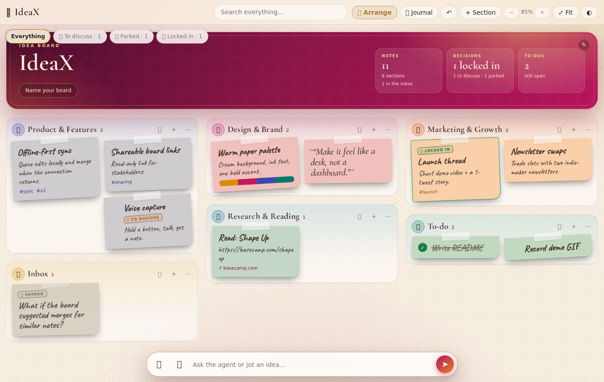

# IdeaX

A shared, auto-arranging idea board. Type a thought, paste a photo or a link, and an agent turns it into a post-it note and files it in the right section. Ask it questions about the board, or have it tidy everything.

The agent runs through a **LiteLLM proxy** with an ordinary LiteLLM key (no Claude subscription or CLI needed), so it works with whatever model your proxy serves. The board runs on your own machine; data stays in local files.




## Features

- Type, paste a link or drop a photo: the agent files it as a post-it in the right section
- Ask the agent questions about the board, or have it tidy everything (**Arrange**)
- Decision stages (to discuss / parked / locked in), journal, search, undo, dark mode
- Works on phones and tablets; optional PIN; all data stays in local files

## Run it

Requires Node 20+ (or Docker) and a LiteLLM proxy key.

```bash
git clone https://github.com/WIRIN-prod/IdeaX.git && cd IdeaX
```

```bash
cp .env.example .env     # then fill in LITELLM_API_KEY (and base URL / model)
docker compose up -d     # http://<this machine>:18001
```

Without Docker: `npm install && LITELLM_API_KEY=sk-... npm start` (default port 3000).

| Variable | Meaning |
|---|---|
| `LITELLM_API_KEY` | **Required.** Your LiteLLM proxy key |
| `LITELLM_BASE_URL` | Proxy URL (default `http://localhost:4000`; in Docker `http://host.docker.internal:4000`) |
| `LITELLM_MODEL` | Model name as configured on the proxy (default `gpt-4o`; use a vision-capable model for photos) |
| `LITELLM_TIMEOUT_MS` | Per-request timeout (default 120000) |
| `BOARD_PIN` | Require this PIN before anyone can open the board |
| `BOARD_PORT` / `PORT` | Docker published port (default 18001) / plain-Node port (default 3000) |
| `HOST`, `ALLOWED_HOSTS` | Bind address; extra hostnames to accept (e.g. a Tailscale name) |
| `WB_DATA_DIR`, `WB_UPLOADS_DIR` | Where `board.json` and photos live (default `./data`, `./uploads`) |

If the proxy is unreachable, notes are still saved (keyword-filed into a section) so nothing typed is lost.

Without `BOARD_PIN`, anyone on your network can open and edit the board.

## Test

`npm test`

## Screenshots

`docs/screenshots/` is generated by `scripts/screenshots.mjs` (needs `npm i --no-save playwright`; set `CHROME_PATH` to a Chromium binary if Playwright's own isn't installed). Install an emoji font first, or icons render as boxes.

## License

[MIT](LICENSE)
